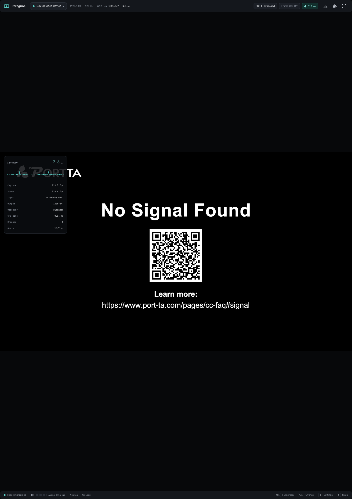

# Lyvra

A low-latency capture card viewer for Linux, with FSR 1 / 3 / 4 upscaling, frame generation and a live latency/performance dashboard.

Licensed under GPL-3.0. See [LICENSE](LICENSE) and [THIRD_PARTY_NOTICES.md](THIRD_PARTY_NOTICES.md).



## What it does

- **Low-latency capture.** V4L2 memory-mapped buffers on a dedicated thread. The render loop wakes on each new frame and always shows the newest one. Older undelivered frames are recycled, never queued.
- **No CPU colour conversion.** The raw NV12 / YUYV / I420 frame is copied once into GPU-visible memory (VRAM with resizable BAR), and a compute shader converts it to RGB (BT.709/BT.601, limited/full range).
- **FSR 1 upscaling.** AMD FidelityFX EASU + RCAS (MIT) as compute shaders, adjustable sharpness. It turns itself off when the output isn't larger than the input.
- **More single-frame options.** **NIS** (NVIDIA Image Scaling, MIT): 6-tap upscale with adaptive sharpening. **Anime4K** (MIT): CNN upscalers (S/M/L, fixed 2×) for anime and cel-shaded games; its mpv shaders are converted to Vulkan compute passes at build time (`tools/gen_anime4k.py`). **AMD CAS** (MIT) sharpens at native resolution, so the Sharpness slider also works in Native mode or when the window is smaller than the capture. GPU cost at 1080p to 4K: CAS 0.02 ms, NIS about 0.7 ms, Anime4K S/M/L about 0.5/1.1/1.9 ms. Split view compares any of them against FSR 1.
- **FSR 3.1 upscaling (experimental).** AMD FidelityFX SDK 1.1.4 (MIT), built natively on Linux. A capture feed has no engine motion vectors, so FidelityFX optical flow estimates them from the video. A small shader then expands them to per-pixel vectors, ignoring ±1 px noise. Two capture-specific fixes:
  - **Synthetic jitter.** The frame is resampled at a Halton sub-pixel offset each frame. Without it FSR 3 converges to blocky, stair-stepped edges.
  - **Reactive mask.** The previous frame is warped by each vector and compared with the current frame. Where they disagree (repetitive textures, particles, transparency, cuts), FSR is told to trust the current frame instead of history.
  - There's no real camera jitter, so expect steadier edges and less shimmer rather than new detail. Split view (C) shows FSR 1 and FSR 3 side by side on the same frame, and the motion debug view marks unreliable vectors with a checker.
- **FSR 4 upscaling (experimental).** AMD's ML upscaler (FSR 4.1) through [fsr4-vk](third_party/fsr4-vk), an independent Vulkan implementation (GPL-3.0). It uses the FP8 model on RDNA 4 and INT8 elsewhere, loaded at runtime via the FFX API. It's fed the same optical-flow motion, synthetic jitter and reactive mask as FSR 3. Handles bad motion vectors much better than FSR 3. In side-by-side gameplay tests it was clearly better than FSR 1 on dense foliage (defined blades instead of a painterly smear) and on par elsewhere, with no ghosting seen. About 3 ms GPU at 1080p to 4K, about 11 ms latency at 1080p60. The first switch to FSR 4 takes about half a second while the model loads.
- **FSR 3/4 quality row.** Chooses FSR's output size as a multiple of the capture resolution; the final composite then resizes it to the window. Options: Auto (window size), Native AA 1.0× (FSR as anti-aliasing, cheapest), Quality 1.5×, Balanced 1.7×, Performance 2.0×, Ultra Performance 3.0×. Measured with FSR 4 at 1080p: Native AA 1.8 ms / 9.9 ms latency, Quality 2.5 ms / 10.6 ms, Performance (4K) 3.2 ms / 11.4 ms.
- **Frame generation (2×, experimental).** FidelityFX frame interpolation (MIT). It uses its own optical flow and motion vectors, so it works with every upscaler. Each new capture frame first shows the generated in-between frame; the real frame follows half a capture interval later, so pacing stays even. It always generates at capture resolution, before upscaling, and the generated frame then gets the same spatial upscaler (FSR 1, NIS or Anime4K; FSR 1 stands in for FSR 3/4, whose history must only see real frames). Moving it before NIS, Anime4K and FSR 3/4 roughly halved its cost at 4K output (NIS + frame gen about 5 ms down to 2.5–3.3 ms on the test pattern). The real frame waits half a capture interval (8.3 ms at 60 fps) plus the generation time. The display needs at least 2× the capture rate. Press G to toggle.
  - **Flow scale.** Optical flow can run on a 75%, 50% or 25% copy of the frame (Auto: 100%, or 50% above 2560 px wide); the generated frame stays full resolution. At 1080p it took frame gen from 2.0 to 1.4 ms (50%) and 1.2 ms (25%). Lower values can make small or thin moving things wobble.
  - **Low-latency mode (predict, experimental).** Shows each real frame the moment it arrives and, half a capture interval later, a frame predicted by pushing the last real frame forward along its motion, instead of waiting for the next real frame. Real frames get the same latency as with frame gen off: motion tracking (about 0.9 ms at 1080p) is submitted after the real frame is presented, and the predicted frame is warped from the real frame as shown (after upscaling, so FSR 3/4 detail is kept). Each vector is checked against the frames: if the previous frame doesn't match where a vector says a pixel came from (HUD text over a moving scene, cuts), or the vector disagrees with last frame's motion there (repeating patterns that fool optical flow), that pixel isn't moved. Predicted frames are guesses, so expect more artifacts than interpolation: smearing at the edges of moving objects, and a one-frame overshoot on sudden stops or turns. On a moving block pattern the prediction lands within 0.1 px of the true position.
  - Protections in interpolation mode:
  - **Fast-motion guard.** When more than 10% of the frame isn't explained by the motion vectors, or more than 25% of it moves faster than 3% of the screen width per frame, the real frame is shown instead (as AMD's AFMF does). Fast flicks drop to native smoothness instead of smearing.
  - **Static-pixel lock.** Pixels unchanged since the previous frame (game HUD text, crosshairs) keep their real value, since there's no HUD-less copy to work from. The anti-aliased edges of HUD text over very fast-changing content can still streak slightly.
- **Present modes.** Mailbox (default), Immediate, or VSync, with 2 frames in flight and the smallest swapchain each mode allows.
- **Audio passthrough.** Finds the capture card's audio input automatically and keeps the output queue within a hard limit (30 ms by default).
- **Stats.** A latency overlay and a Performance panel with a per-stage latency breakdown (USB transfer, queue, CPU, GPU convert / upscale / composite), frame-time graph, fps, dropped frames and signal path.
- **Device picker.** Capture cards are listed before webcams, the best mode is picked automatically, and your choice is remembered.

Measured on a DX20R (1080p120 NV12) with an RX 9070 XT: about 7.7 ms from capture timestamp to frame ready, 0 dropped frames, about 0.04 ms GPU without upscaling and about 0.5 ms with FSR 1 to 4K. Roughly 7.2 ms of that is the USB transfer of one frame itself. FSR 3.1 to 4K (including optical flow) costs about 0.6–2.3 ms GPU, about 9–10 ms total at 1080p60.

## Build

Needs: CMake ≥ 3.20, a C++20 compiler, Python 3, SDL3, libturbojpeg (libjpeg-turbo ≥ 2.0, for MJPEG modes), the Vulkan loader, `glslc` (shaderc) and `glslangValidator`. Dear ImGui, FSR 1, CAS, NIS and the Vulkan headers are git submodules; a trimmed FidelityFX SDK 1.1.4 and the fsr4-vk source are vendored in `third_party/`. The first build compiles about 250 FidelityFX shader variants (around 7 s on 32 threads).

**FSR 4 (optional).** Build fsr4-vk from `third_party/fsr4-vk` by following its README. You need AMD's `amd_fidelityfx_upscaler_dx12.dll` from FidelityFX SDK 2.3.0; its setup verifies the hash and extracts the model, and the result is `build/linux/amd_fidelityfx_upscaler_vk.so`. Then either configure Lyvra with `-DLYVRA_FSR4_VK_LIB=/path/to/amd_fidelityfx_upscaler_vk.so` (copied next to the binary and installed to `lib/lyvra/`), or put the file in `~/.local/share/lyvra/`, or set `LYVRA_FSR4_LIB`. Without it, FSR 4 is greyed out.

```bash
git clone https://github.com/zeex64/lyvra.git
cd lyvra
git submodule update --init --depth 1   # not --recursive: FSR 1's own sample submodules aren't needed
cmake -S . -B build -G Ninja -DCMAKE_BUILD_TYPE=Release
ninja -C build
./build/lyvra
```

Your user must be in the `video` group to open `/dev/video*`.

## Install

`install.sh` checks dependencies, fetches submodules, builds and installs Lyvra with a launcher entry and icons:

```bash
./install.sh                         # for your user: ~/.local (no sudo)
./install.sh --system                # for everyone: /usr/local (sudo)
./install.sh --fsr4-lib /path/to/amd_fidelityfx_upscaler_vk.so   # also enable FSR 4
./install.sh --uninstall             # remove it again (settings in ~/.config/lyvra are kept)
```

Re-run it after `git pull` to update. If the build directory was configured with `-DLYVRA_FSR4_VK_LIB`, the FSR 4 library is installed automatically.

### Options

| Flag | |
|---|---|
| `--device /dev/videoN` | Open this device |
| `--fullscreen` | Start fullscreen (this run only) |
| `--selftest N` | Run N seconds, printing live stats every second |
| `--screenshot file.ppm` | With `--selftest`, save the final composited frame |
| `--show settings[:tab] / stats / picker` | Open a panel at start |
| `--upscaler off / fsr1 / nis / anime4k / fsr3 / fsr4` | Override the upscaler for this run |
| `--anime4k s / m / l` | Anime4K network size for this run |
| `--sharpness 0..1` | Sharpness for this run |
| `--no-framegen` | Turn frame generation off for this run |
| `--fg-predict` / `--no-fg-predict` | Frame generation low-latency (predict) mode on/off for this run |
| `--flow-scale auto / 100 / 75 / 50 / 25` | Frame generation optical-flow resolution for this run |
| `--quality auto / native / quality / balanced / performance / ultra` | Override the FSR 3/4 quality for this run |
| `--debug-motion` | Show the optical-flow motion field (FSR 3) |
| `--test-pattern` | Synthetic frames: left half moves right 4 px/frame, right half static |
| `--test-pattern=smooth` | Anti-aliased stripes and rings repeating every 960 px; top half moves 1.37 px/frame |
| `--compare` | Split view: FSR 1 left, FSR 3 right |
| `--no-jitter` | Disable FSR 3 synthetic jitter (for A/B) |
| `--framegen` | Turn frame generation on for this run |
| `--test-pattern=fast` | Blocks moving 150 px/frame (exercises the frame-gen guard) |
| `--no-fglock` | Disable the frame-gen static-pixel lock and guard (for A/B) |
| `LYVRA_VALIDATION=1` | Enable Vulkan validation layers |

### Shortcuts

F11/F fullscreen · Tab overlay · S settings · P performance · D device · M mute · U cycle Native / FSR 1 / NIS / Anime4K / FSR 3 / FSR 4 · C split view · G frame generation · F12 screenshot (a generated frame when frame gen is on) · Esc close · Ctrl+Q quit

Settings live in `~/.config/lyvra/settings.ini`.

## Layout

```
src/capture.*    V4L2 enumeration, mode selection, capture thread, MJPEG decode
src/renderer.*   Vulkan 1.3: YUV→RGB compute, FSR 1, composite, timestamps
src/temporal.*   FSR 3.1: FidelityFX optical flow -> motion vectors -> FSR 3.1 upscaler
src/framegen.*   Frame generation: optical flow -> motion vectors -> FI prepare -> FI dispatch (or, in predict mode, a checked motion field)
src/anime4k.*    Runs Anime4K passes (generated by tools/gen_anime4k.py) with mpv-style texture sizing
src/audio.*      SDL3 audio passthrough with bounded latency
src/ui.*         Dear ImGui UI (top/bottom bars, overlay, settings, performance, picker)
src/main.cpp     Event loop, device lifecycle, stats
shaders/         yuv.comp, easu.comp, rcas.comp, cas.comp, nis.comp, motion.comp, predict.comp, blit.vert/frag, frame-gen helpers
cmake/           fidelityfx.cmake (Linux build of the SDK subset + shader generation), compat shims
tools/ffx_sc/    FidelityFX shader compiler ported to Linux (GLSL path)
tools/ffx_smoke/ Creates and dispatches the FidelityFX contexts headlessly
```

## Roadmap

- **Display-side latency** via `VK_KHR_present_wait`, so the number includes compositor and scanout.
- HDR passthrough and recording.

## Renaming

The name is set in `src/settings.h` (`APP_NAME`, `APP_ID`), in `CMakeLists.txt` (project and target) and in `data/lyvra.desktop`.
